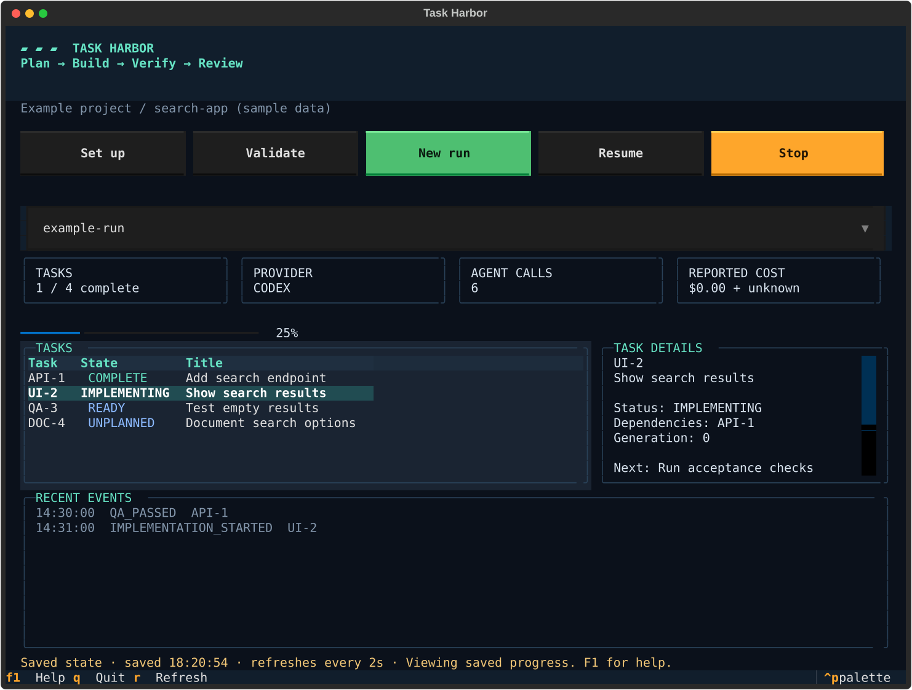
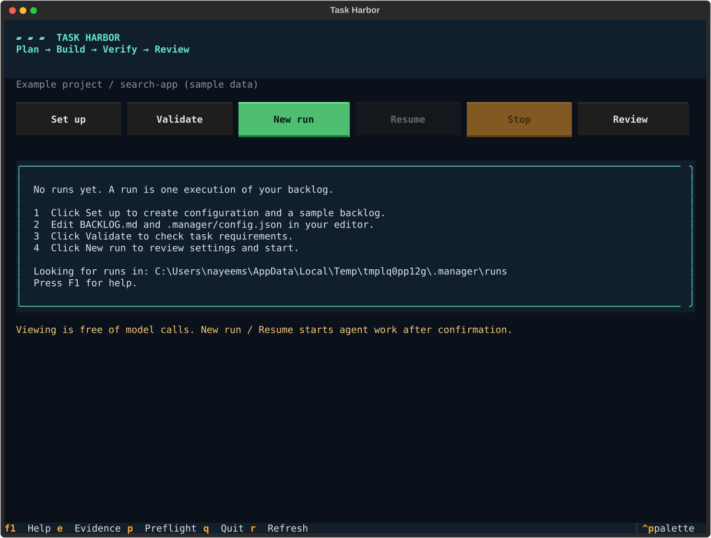
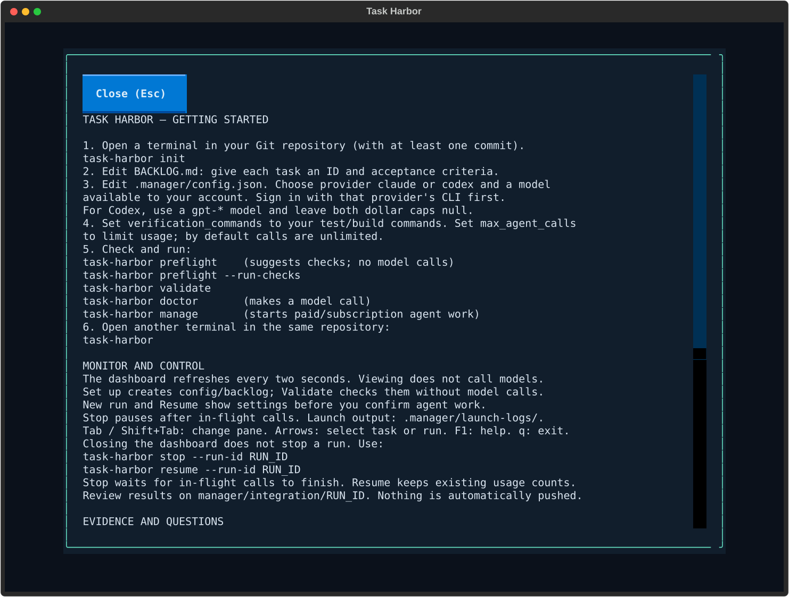

# Task Harbor

Task Harbor is a command-line tool that runs coding tasks with Claude Code or
Codex. It reads a Markdown backlog, plans each task, makes changes in separate
Git worktrees, and checks the results before merging them into a local branch.

It does not push changes or merge them into your original branch. You review the
result on `manager/integration/<run-id>`.

## Install

You need Python 3.11+, Git, and either Claude Code or Codex installed and signed in.
The repository you want to work on must have at least one commit and a configured
Git author.

Install the Python package directly from this repository (no clone required):

```sh
python -m pip install "git+https://github.com/rhit-nayeems/task-harbor.git"
task-harbor --version
task-harbor guide
```

The dashboard is included. This project is not published to PyPI yet; do not use
`pip install task-harbor` expecting this repository's package.

<details>
<summary>Isolated install, upgrades, and command-not-found fixes</summary>

With pipx installed, use an isolated application environment:

```sh
pipx install "git+https://github.com/rhit-nayeems/task-harbor.git"
pipx ensurepath
```

Restart your terminal after changing PATH. For a regular pip installation,
`python -m task_harbor` works with the same arguments if the executable is not
on PATH. Use the same Python interpreter you installed with.

Upgrade a pip installation:

```sh
python -m pip install --upgrade "git+https://github.com/rhit-nayeems/task-harbor.git"
```

For pipx, use `pipx upgrade task-harbor`. Uninstall with `python -m pip uninstall
task-harbor` or `pipx uninstall task-harbor`, respectively.

</details>

[First run](#start-a-run) · [Commands](#cli-commands) · [Configuration](docs/CONFIGURATION.md)

## Terminal dashboard



<details>
<summary>See first-run setup and built-in help</summary>




</details>

These are captures of the actual terminal interface. The task dashboard uses
sample run data. Open it inside your project:

```sh
task-harbor
```

Running `task-harbor` (or `python -m task_harbor`) without a command opens the
dashboard for the current directory. `--help` lists the other commands.

The dashboard shows saved runs, task status, dependencies, recent events, agent
calls, and reported costs. Select a run with the picker and use the arrow keys
to inspect tasks. Tab changes panes, F1 opens help, `r` refreshes, and `q` exits. It also
refreshes automatically every two seconds.

Use `tui --run-id <id>` to open a specific run. Start or resume work in another
terminal with the commands below. The dashboard only reads local files; it
doesn't run agents or consume tokens. Unreported costs are shown as unknown.

## Start a run

Replace `path/to/your-app` with the repository you want Task Harbor to work on.
Use `--repo` before the command.

```sh
task-harbor --repo "path/to/your-app" init
```

This creates `.manager/config.json` and a sample `BACKLOG.md` in that repository.
An existing backlog is kept. Replace the sample task with your own work:

```markdown
## BUG-001 — Fix empty search results
- **Priority:** critical_bug
- **Status:** UNPLANNED
- **Dependencies:** —
- **Acceptance criteria:**
  - An empty search shows a message instead of crashing
  - Existing search tests pass
- **Next action:** Plan the task
```

Use a different ID for each task. List dependency IDs separated by commas.
See [BACKLOG.example.md](BACKLOG.example.md) for a longer example.

### Choose Claude or GPT

Edit `.manager/config.json` before starting. Claude is the default:

```json
{
  "provider": "claude",
  "model": "opus",
  "effort": "medium"
}
```

For GPT, sign in with `codex login` and change these fields:

```json
{
  "provider": "codex",
  "model": "gpt-6.1-sol",
  "effort": "medium",
  "max_run_cost_usd": null,
  "max_call_cost_usd": null
}
```

Use a model available to your account. Provider choice applies to the whole run;
you cannot switch providers when resuming it.

### Set checks and limits

Add your project's test or build commands to the configuration. For example:

```json
{
  "verification_commands": ["python -m pytest"],
  "max_agent_calls": 100,
  "max_task_agent_calls": 20
}
```

These call limits are examples; the defaults are unlimited. Both providers support
call limits and timeouts. Only Claude supports estimated dollar caps. Codex
requires both dollar-budget settings to be `null`.

Now validate the backlog, check the selected agent, and start:

```sh
task-harbor --repo "path/to/your-app" validate
task-harbor --repo "path/to/your-app" doctor
task-harbor --repo "path/to/your-app" manage
```

`doctor` makes a model call. `manage` uses model calls throughout the run and
prints a run ID. Save that ID to check progress or resume later.

## CLI commands

All commands accept `--repo` before the command. Replace `RUN_ID` below with the
ID printed by `manage`.

| Command | What it does |
| --- | --- |
| `guide` | Setup, usage, and troubleshooting help |
| `tui` (or no command) | Open the dashboard |
| `--version` | Show installed version |
| `init` | Create the configuration and sample backlog |
| `validate` | Check backlog format and dependencies without calling a model |
| `doctor` | Validate the backlog and make a test call to the selected agent |
| `manage` | Start a new run |
| `status --run-id RUN_ID` | Show saved task status and usage |
| `report --run-id RUN_ID` | Print a JSON report |
| `report --run-id RUN_ID --html report.html` | Save an HTML report |
| `stop --run-id RUN_ID` | Request a pause after in-flight calls finish |
| `resume --run-id RUN_ID` | Continue a saved run |
| `retry --run-id RUN_ID --task BUG-001` | Allow a blocked task to try again; then use `resume` |
| `cleanup --run-id RUN_ID` | Remove run worktrees, keeping branches and logs |

Status, reports, stop, retry, and cleanup do not call a model. Reports are
snapshots; generate a new one to see updates. Retry and resume keep existing
usage counts.

## What happens during a run

Task Harbor plans up to four tasks at once, but implements them one at a time.
Each implementation gets a local checkpoint commit. Configured checks run first,
then a separate agent checks the acceptance criteria. Passing work is merged into
the integration branch, with code review every three passes by default.

A failed task gets two repair attempts in the same session. Further failures
trigger diagnosis and a fresh session, up to a configured limit.

Run state, plans, checks, and logs are saved under `.manager/runs/<run-id>/`.
Worktrees are stored beside your repository. Edit task requirements before
starting a new run; `resume` uses saved requirements, not later backlog edits.

Agents execute local commands. The permission settings and worktrees are not a
substitute for an isolated machine when working with untrusted code. After a hard
crash, stop any remaining agent processes before resuming.

## Development

```sh
python -m pip install -e ".[dev]"
python -m pytest
```

Tests use simulated agent responses and real temporary Git repositories. CI runs
on Windows and Linux with Python 3.11 and 3.14. These tests do not establish live model quality or account compatibility; see
[EVALUATION.md](EVALUATION.md) for opt-in live evaluations.

- [Configuration and provider details](docs/CONFIGURATION.md)
- [Architecture](ARCHITECTURE.md)
- [Workflow](WORKFLOW.md)
- [Evaluation](EVALUATION.md)
- [Changelog](CHANGELOG.md)
