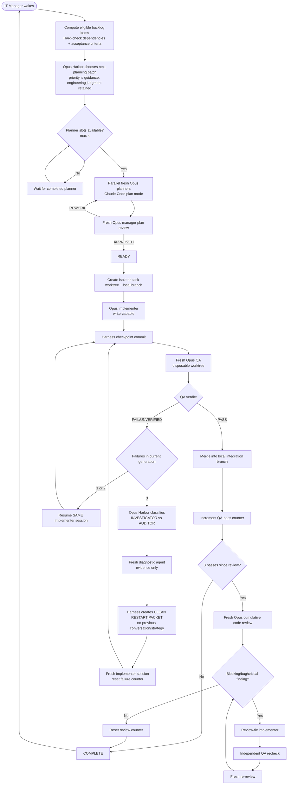

# Implemented workflow

## Intentional changes from the original sketch

1. **No startup planner deadlock.** Planner capacity is simply a hard maximum of four. When a slot exists and eligible work exists, the manager may fill it.
2. **Blocking is a condition, not a fake lifecycle state.** A task keeps its lifecycle status and gets a concrete blocked reason.
3. **Read-only independence is enforced by context/worktree boundaries, not only prose.** QA uses a disposable worktree; planning roles use Claude Code plan mode.
4. **The third-strike replacement gets evidence, not inherited reasoning.** The old session ID is retired.
5. **Code-review fixes explicitly go through QA recheck and then fresh re-review.**
6. **Autonomy is bounded.** Repeated clean restarts and review-fix loops have configurable safety ceilings so a pathological task cannot consume tokens forever.
7. **Write-capable task execution is serialized in v0.3.** This is a deliberate correctness choice. Parallel planners provide substantial throughput without introducing semantic branch-integration races. The worktree design supports a later conflict-aware parallel implementation scheduler.
8. **Approved plans are revalidated when integration advances.** Parallel planning remains useful, but an older plan is not handed to an implementer without a fresh manager judgment against the current integration state.
9. **Passes count only after merge.** A successful isolated QA verdict does not advance the periodic-review counter until the task branch is actually integrated; replay is idempotent per checkpoint.
10. **Interrupted transitions are recoverable.** Resume converts in-flight lifecycle states into the smallest safe repeatable action instead of pausing with "no executable transition."
